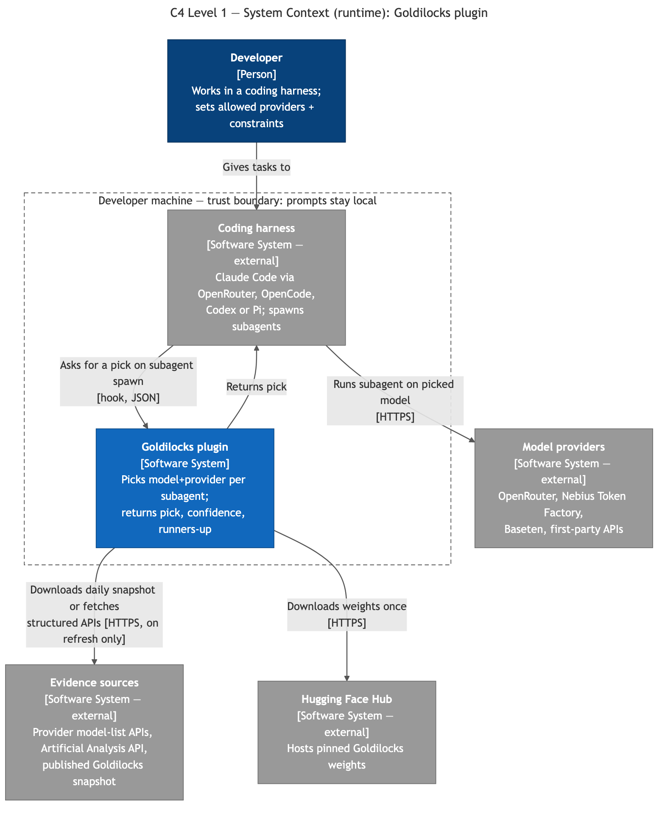
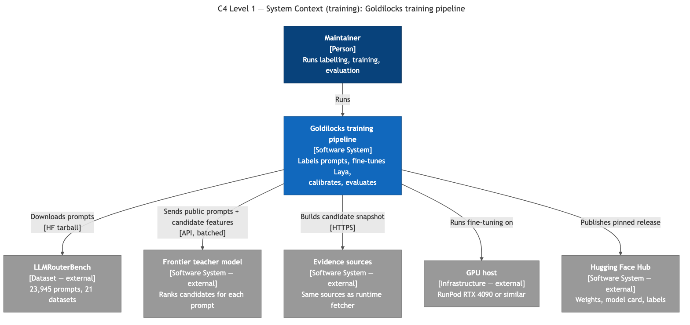
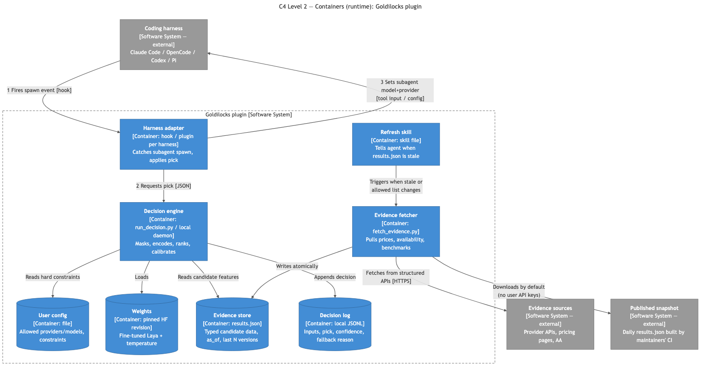
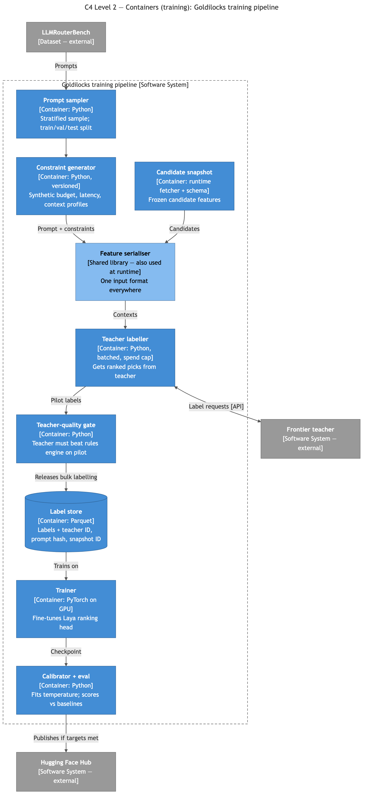
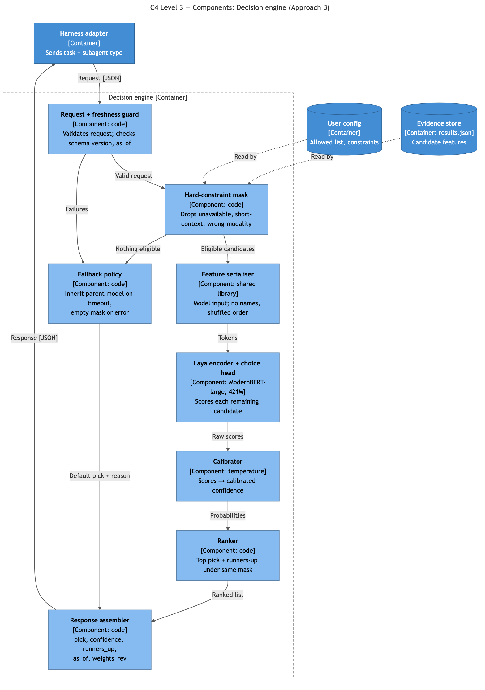
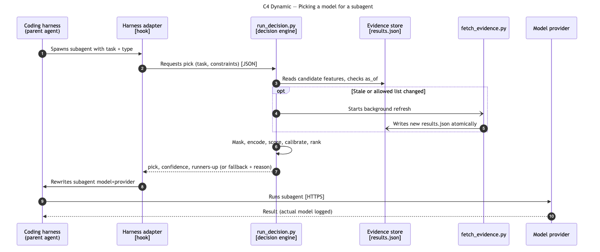

# Goldilocks: per-subagent model picker for coding harnesses

* **Author:** mani2001
* **Date:** 2026-11-15
* **Base document:** [`PLAN.md`](PLAN.md). This brief rewrites it and supersedes it wherever the two disagree. See "What changed from PLAN.md" at the end.
* **Status:** Brainstorm brief, reviewed by seven review agents, each in a separate context with no conversation history (design, codebase details, zoom-out, comprehension, implementation readiness, structure, inventive catalyst).

## Overview

When a coding harness (Claude Code, OpenCode, Codex or Pi) starts a subagent, the parent agent must choose a model for it. Today that is either a fixed default or a guess. Goldilocks is a plugin that makes the choice. It receives the subagent's task and the user's constraints, and returns:

1. **A pick:** one model *and* one provider (the same model can cost 2–15x more on one provider than another).
2. **A calibrated confidence score** for that pick.
3. **Runners-up:** the next-best candidates under the *same* constraints.

It can also choose a model for the main session, if the harness allows the session's model to be changed (see Risk 5).

The decision is made by a small local model: **Laya** (`convaiinnovations/laya-typed-decisions`, a ModernBERT-large encoder plus a decision head, 421M parameters), fine-tuned to rank candidates. It is trained to reproduce the picks of a large frontier "teacher" model at a small fraction of the teacher's cost per decision. The teacher sees the task plus each candidate's price, capability and cost-per-task features, and its pick is the training label. All training, validation and test data come from **LLMRouterBench** prompts labelled by that teacher.

The plugin does not search the web on each decision. It ships two scripts:

1. **`fetch_evidence.py`** collects current prices, availability and benchmark data from a fixed list of sources into `results.json`.
2. **`run_decision.py`** takes the subagent prompt, `results.json` and the user's allowed-model list, and prints the pick.

A harness hook calls `run_decision.py` when a subagent is spawned, so the orchestrator model spends no tokens on the decision. A skill and the scripts refresh `results.json` when it is older than its time-to-live (default 24 h) or when the user changes their allowed list.

**Target user:** a developer whose harness spawns many subagents. Goldilocks lets cheap tasks run on cheap models and saves expensive models for hard tasks, without the developer choosing each time.

### Architecture at a glance (C4)

**Level 1: system context at runtime.** At runtime, Goldilocks lives on the developer's machine next to the harness. Prompts stay local. Goldilocks only goes online to refresh evidence and to download weights once.

**Level 1: system context for training.** Training is a separate system. The teacher and the GPU appear here only. They are never called when a decision is made at runtime.

**Level 2: containers at runtime.**

**Level 2: containers for training.** The feature serialiser is shared: training and runtime must build model inputs in exactly the same way, or the model reads inputs at runtime that differ from what it was trained on.

**Level 3: components inside the decision engine.** Hard constraints are applied in code *before* the model scores anything, so the model cannot pick, or list as a runner-up, a candidate the user cannot use.

**Dynamic view: one subagent spawn.**

Diagram sources (Mermaid) are in `docs/diagrams/src/`.

## Analysis

### Arguments settled from the 2026-11-15 team discussion

The team discussed the open questions on a call. Each argument below gives the verdict and the reason. Where a verdict depends on something not yet checked, it says so.

**S1. Will the student just copy the training set's pick distribution, or adapt when prices change?**
*Verdict:* Including price as an input feature is necessary but not enough, and an ordinary held-out test set will not catch the problem.
- **Why price alone is not enough.** If every label is made from one price snapshot, each model has exactly one price in the whole training set. The price column then carries the same information as the model's name. The student can reach full accuracy by learning "this candidate usually wins" and ignoring price.
- **Why the test set won't catch it.** A held-out test split drawn from the same snapshot has the same prices, so the shortcut scores perfectly there too. The objection that "the test set catches overfitting" is right in general but fails here, because train and test share the same price-to-model pairing.
- **What to do instead.** Teach price sensitivity through counterfactual labelling:
  - When building teacher contexts, randomly rescale prices, and to a lesser degree capability scores, per example.
  - Hide or randomise model names.
  - Vary which candidates appear in each pool.

  The teacher then sees, for example, Sonnet both cheap and expensive, and its labels show how the pick should change.
- **Pass/fail check.** Keep a separate **price-shift test set**: the same prompts with prices changed in ways the training set never used. The student must follow the teacher's changed picks on it.

**S2. "Calibration on 50 dev tasks is noisy."**
*Verdict:* This objection no longer applies. It assumed the 100-task set, which has been dropped. LLMRouterBench has about 24k prompts, which is enough for a separate calibration split. The meaning of confidence still holds: it is the probability the teacher would make the same pick. The team accepts that as the claim, on the grounds that "we rely on the frontier model's decision."

**S3. If the teacher's decision is the ground truth, why not just let the frontier orchestrator decide?**
*Verdict:* The student has a real job, but the reason is narrower than "save money".
- **What doing it inline costs.** The orchestrator would have to load the evidence table, about 2–5k tokens, into its context for every spawn and reason over it. At Opus 5.5 prices ($4 in / $20 out per 1M) that is roughly 1–3 cents per spawn. It also fills the orchestrator's context with evidence that has nothing to do with the task, and the picks are not reproducible from run to run.
- **What the student gives instead:** the teacher's decision at near-zero cost per call, the same answer for the same input, a calibrated confidence, and no orchestrator tokens at all.
- **Where the large savings come from.** Most of the money saved comes from running subagents on cheaper models, and the inline approach (C) would capture that too.
- **The claim to make:** "the teacher's choice, without the teacher's per-decision cost or context use."

**S4. Live web search on every decision, or a cached snapshot?**
*Verdict:* Use a cached snapshot. The argument that a 5–20 s delay is acceptable is about latency, but latency is not the main reason. The evidence (prices, availability, benchmark scores) is the same whatever the subagent's task is, so searching on every spawn fetches the same data hundreds of times a day. What depends on the task is the matching of task to candidate, and that is the student's job. The team reached the same conclusion on the call ("never use search, use extract"). The file is **`results.json`**, not `.md`; both sides agreed on that during the call.

**S5. Does the orchestrator still need a reasoning loop to turn evidence into model input?**
*Verdict:* Not on each decision.
- **When a subagent is spawned:** a hook passes the subagent prompt straight to `run_decision.py`, which reads the typed `results.json`. No LLM is involved.
- **When `results.json` is refreshed:** a reasoning step is needed only if a source returns unstructured HTML. Then an LLM extracts numbers once per refresh, and the extracted values must pass checks before they are written:
  - range checks;
  - comparison with the previous snapshot (flag price changes over 50%);
  - every model in the allowed list is present.

  Structured APIs need no LLM step at all.

**S6. Where does benchmark data come from: the Artificial Analysis API key, a general scraper (Tavily/Exa extract or crawl), or many benchmark sites such as Vals?**

This was the main unresolved argument. *Verdict:* use structured sources, fixed per feature-schema version, and a published snapshot so users need no keys.
- **Data sources are fixed when the model is trained.** The student learned from features built from specific sources through the capability mapping. A score scraped from Vals at runtime does nothing unless the mapping includes it, and changing the mapping changes the inputs the student sees. So "support any benchmark site the user trusts" is not something runtime scraping can deliver. Adding a source is a schema change: update the mapping, version it, and check it against the eval set.
- **Use structured APIs for numbers.** Prices and benchmark scores feed straight into the model. Scraping HTML breaks when page layouts change. Extracting numbers from HTML with an LLM can copy a number wrongly with no visible error. The Artificial Analysis API returns typed per-benchmark data. The OpenRouter benchmarks API seen on the call may be a second structured source; its access terms are not yet checked. Provider prices and availability come from each provider's model-list API: OpenRouter `/api/v1/models`, which is public, and each other provider's `/v1/models` with the key the user already has for that provider.
- **Answer to "too many dependencies on the user": a published snapshot.** The maintainers run `fetch_evidence.py` on a daily schedule, for example GitHub Actions, and publish a signed `results.json` to the repo or to HF. The plugin downloads that by default, so users need **no API keys** for benchmark data. Users who want fresher data, or their own sources, run the fetch script with their own keys. *Unverified:* whether Artificial Analysis's terms allow redistributing its numbers this way. If they do not, every user must use their own free key. A first-run prompt can open the sign-up page, as suggested on the call.
- **General scraping (Tavily/Exa extract) is the fallback**, used only for sources with no API. It is restricted to a fixed allow-list of URLs, its output is validated (see S5), and it is never fed to the model as free text.

**S7. Main agent or subagents?**
*Verdict:* both, chosen by the user in config; a plugin setting, not a model question.
- **Subagents:** picked when the orchestrator spawns them. Once a subagent is running it cannot change its own model, as agreed on the call.
- **Main agent:** the idea is that a prompt-submit hook picks a model before the first request, while Claude Code shows a default model but hasn't sent anything yet. *Unverified:* whether any harness lets a hook change the session's model at that point. The harness spike (Risk 5) must test this specifically.

**S8. How is this different from OpenRouter's router or gateway routers (Vercel, LangSmith, others)?**
*Verdict:* being open source alone is not a reason for users to choose Goldilocks. The brief should claim only what a gateway-side router cannot do:
- it works across gateways and direct providers;
- it respects the user's own allowed list and constraints;
- it runs locally next to the harness, and the prompt never reaches a routing service;
- it picks a model for each subagent inside the agent loop;
- it returns a calibrated confidence and runners-up.

*Unverified:* what OpenRouter's router actually bases its picks on (the call said traffic, not benchmarks). Check this before the brief makes any comparison.

### Review findings

The review agents agreed with each other more than usual. Two problems sit under most of the others: **nothing checks the labels against real outcomes**, and **the design treats three things as settled that it has not tested**: the harness hook points, the runtime install, and a candidate pool that changes over time. The risks below are ordered by severity.

### Blocking risks

**1. The teacher is unproven, and nothing checks picks against real results.**
In this design, "correct" means "agrees with the teacher". On Day 0, the prompted teacher (Qwen3-235B) made exactly the same picks as the simple rules engine. LLMRouterBench's measured results cover 33 older models, none of them current candidates. So once teacher labels replace them, the dataset supplies prompts only. Dropping the 100-task set removes the last link to real task success. A student trained on a teacher can at best equal that teacher on the teacher's own labels. Hitting every accuracy target would still say nothing about whether the picks are good.
*Mitigation:*
- **Gate the teacher before bulk labelling.** Run it on a pilot of about 200 prompts first. For a subset, actually run 3–4 current candidates and score their answers with the dataset's answer key. Separately, check the teacher's picks among the 33 older models against LLMRouterBench's measured best for those prompts.
- **What passing means:** the teacher must clearly beat `rules_engine.py`, and a human spot-check of about 50 items must agree with it.
- **If you skip the gate**, the brief must state the only claim plainly: "Goldilocks matches teacher X at Y% of its cost."

**2. What the confidence number means.**
Calibrated against teacher labels, confidence 0.8 means "80% chance the teacher would agree", not "80% chance this model completes the task". Users will read it as the second. There are also three mechanical problems:
- One temperature is fitted on one snapshot of the candidate pool, and it drifts when `result.md` refreshes.
- Removing candidates with the hard-constraint mask changes the probability distribution after calibration.
- "RLCD" in PLAN.md is never defined.

*Mitigation:*
- Choose and document what event confidence predicts, and label it honestly to users.
- Fit the temperature *after* masking, on a separate calibration split.
- Report ECE, Brier score and a reliability diagram against set targets.
- Ask the teacher for a score on every candidate, or sample it several times, rather than taking only its single top pick. A single top pick gives confidence and runners-up nothing to learn from beyond the winner.

**3. The candidate pool changes, and Approach B as written memorises names.**
B puts the task and every candidate (name, prices, scores, all as text) into one sequence of at most 1,024 tokens. Two problems follow:
- **Name memorisation.** The model will learn shortcuts like "Sonnet usually wins" instead of reading the features. When `result.md` refreshes with new models or prices, it meets inputs it never saw in training and gives no warning.
- **Length.** About 20 candidates plus a long subagent prompt will not fit in 1,024 tokens.

PLAN.md also contradicts itself: §3 scores each (task, candidate) pair separately, while §4.1 reads all candidates in one sequence.

*Mitigation, staying within B:*
- **Have Laya read only the task text.** Pass each candidate as an unnamed, normalised numeric feature vector, and let a small learned head score each (task, candidate) pair. This removes the token limit and the name-memorisation shortcut, and works for any pool size. Most review agents named this as their top recommendation.
- **If the single-sequence form stays**, use these training defences:
  - strip names;
  - shuffle candidate order;
  - add small random changes to prices and scores;
  - train on random subsets of the pool;
  - test on candidates held out from training, with a pass threshold.
- **One versioned input-format definition** shared by labeller, trainer and runtime. The engine refuses to run if the format version does not match.

**4. Training prompts do not look like subagent prompts.**
LLMRouterBench is short, single-turn academic questions (maths, QA, code puzzles). Subagent prompts are long, multi-step, use tools and carry repository context. Most of a subagent's cost comes from tool loops, which LLMRouterBench does not exercise. A model that scores well on the LLMRouterBench test split may still pick badly for real subagent prompts.
*Mitigation:*
- Build an evaluation set of 100–300 realistic subagent prompts, such as SWE-bench/SWE-Gym task statements, or LLMRouterBench items rewritten into subagent style that keep their answer keys.
- Pass the subagent type (explore, plan, implement, review, test) as a structured input.

**5. The harness hook points are unverified.**
The plan assumes every harness lets a plugin change a subagent's model and provider when the subagent is started. The review agents doubt this for each harness:
- **Claude Code.** The OpenRouter route may be environment variables rather than an extension; the name and mechanism are unconfirmed. If it is environment variables, the base URL is fixed when the process starts, and per-subagent provider choice may need a local routing proxy. The likely hook is a `PreToolUse` hook that rewrites the subagent tool's input.
- **OpenCode.** Agent models are set in static config. Changing them when a subagent starts is unconfirmed.
- **Codex.** Native subagents with different models is unconfirmed.
- **Pi.** May not have built-in subagents at all.
- **Main session.** Switching its model mid-conversation throws away the provider's prompt cache. On long sessions, that can make a "cheaper" pick cost more overall.

*Mitigation:*
- Run a one-day spike per harness. The test: one subagent whose model and provider were picked when it started and actually used, confirmed by billing or response headers.
- Choose the first harness from the results.
- Limit main-session switching to the start of a session, and only when the expected saving is larger than the cost of losing the prompt cache.

### Major risks

**6. No stated reason for the cost of B.** A teacher call costs about $0.0003 per decision, and a subagent run costs cents to dollars. Fine-tuning and shipping a 421M model saves very little per call. State the actual reason for B: it runs offline, prompts never leave the machine, it publishes open weights on Hugging Face, or it lays the groundwork for learning from outcomes later. Make the rules engine, a scoring function (A) and the prompted teacher (C) required baselines that B must beat.

**7. No plan for failures.** Several failure cases have no defined behaviour:
- the daemon is down or times out;
- `result.md` is missing or corrupt;
- every candidate is removed by the mask;
- confidence is low;
- the provider returns 404 or 429;
- the harness ignores the pick.

Write a table with one row per failure: the action (default: keep the parent's model), whether it is logged, and whether the user is told. Never block a spawn because Goldilocks failed. Keep a local decision log containing:
- inputs and candidates before and after the mask;
- the top probabilities;
- a hash of the weights;
- the `result.md` date;
- latency;
- the model that actually ran.

**8. Making `results.json` refresh reliably. Partly settled: S4–S6 chose JSON, typed sources and a published snapshot. These points still apply:**
- Make `result.json`, with a schema version and typed fields, the file the engine reads. Generate `result.md` from it for humans to read.
- Have code, not the agent, check the file's age and whether the allowed list has changed. If the file is stale, serve the pick from the old file and refresh in the background.
- Write refreshes atomically and keep the last few versions.
- Treat 404 and 429 errors as a trigger to refresh.
- Never pass scraped free text to the model. Text taken from web pages could carry instructions aimed at the agent (prompt injection).

**9. Installation and latency are not specified.**
- The model is about 1.7 GB in full precision, plus PyTorch. On a laptop CPU it takes hundreds of milliseconds to seconds per decision; the 33 ms figure is on a GPU.
- Suggested setup: one local daemon shared by all harnesses, an ONNX int8 export (about 450 MB, no PyTorch), weights pinned to a Hugging Face revision, a latency target with a timeout that falls back to a default, and benchmarks on Apple Silicon and x86 CPUs.

**10. The labelling budget is understated by 100–1,000x.** PLAN.md's $0.30–$0.60 assumed 1–2k tasks with Qwen3. The new scope is roughly 24k prompts, times several constraint profiles, times possibly several samples each, labelled by a frontier teacher. One pass alone is about $280–560. Label a stratified sample of 3–5k first, with a hard spending cap, and check how accuracy grows with more data before labelling more.

**11. Constraints and "cost per task" are undefined.** LLMRouterBench has no constraints, so budget, latency and context profiles must be generated. Define:
- a fixed vocabulary for constraints;
- which constraints are hard (applied as a mask in code) and which are soft (features the model weighs);
- what to return when nothing is feasible: code reports which constraint blocked every candidate;
- the cost-per-task formula and where its token estimates come from.

**12. "Provider" has several meanings.** It can mean the company hosting the model, OpenRouter's upstream host, the harness's backend, or a "Fast" price tier. Define it once and keep one registry of IDs. Consider having the model pick only the *model*, then choosing the cheapest provider that meets the constraints with a lookup. That roughly halves the candidate list and keeps the fastest-changing data (prices) out of the learned part.

**13. Licences and data provenance.** LLMRouterBench's 21 source datasets have mixed licences, and Artificial Analysis restricts redistribution of its data. Write a data card covering licences and contamination before publishing anything derived from them.

### The trade-offs underneath, and the best outcome

| Conflict | How to remove it |
|---|---|
| A fixed local model vs. a candidate pool and prices that keep changing | Laya encodes the task; candidates are unnamed numeric vectors scored by a learned head. Training uses perturbed copies and random subsets of the pool. |
| Cheap labels at scale vs. knowing the labels are right | Gate the teacher on a measured pilot. Ask it for scores on every candidate. Log outcomes the harness already produces (completed or errored, retries, tests passed, token spend) for later recalibration. |
| Ready-made academic prompts vs. relevance to subagents | Use LLMRouterBench for the bulk of training. Adapt and test on subagent-style prompts. Pass the subagent type as an input. |
| Calibrated confidence vs. a label that means little | Define confidence as "probability the pick is within ε of the best cost-adjusted option". Below a threshold, fall back. |
| Privacy and no per-call cost vs. install friction | One shared ONNX daemon, decision caching, and a rules-engine fallback when the daemon is unavailable. |
| Best model per decision vs. losing the prompt cache | Switch the main session only at boundaries (session start, after compaction), and only when the switch pays for itself. |

**Best outcome (Ideal Final Result):**
- When a subagent starts, a hook calls the local daemon.
- In well under 100 ms on a CPU, the daemon encodes the task once and scores it against precomputed vectors for the allowed candidates.
- Hard constraints are a mask in code, and the provider is a lookup.
- It returns a pick, an honestly labelled confidence, and runners-up under the same constraints.
- Adding a model needs no retraining. A missing daemon never blocks a spawn.

## Goals vs. Non-Goals

* **In-scope goals (v1):**
  * **G1.** For each subagent started in the first harness (chosen by spike), return pick (model + provider), calibrated confidence, and *k* runners-up under the same constraints, within a set warm-latency budget.
  * **G2.** Never break a hard constraint. This is guaranteed by the mask in code, not learned.
  * **G3.** Agreement with the teacher on held-out LLMRouterBench data: top-1, top-3, and the cost of a wrong pick. Report it on held-out *prompts*, held-out *datasets* and held-out *candidates*, with a stated ECE target.
  * **G4.** On the same splits, beat: `rules_engine.py`; a fixed subagent-type → model-tier map; a feature-only gradient-boosted or logistic model; plain ModernBERT-large; and frozen Laya embeddings with nearest-neighbour lookup.
  * **G5.** Work offline after install. Evidence refresh is atomic, keeps the last good file on failure, and is enforced by code.
  * **G6.** Fall back to a default, deterministically and visibly, whenever the model is missing, slow, unsure, or seeing unfamiliar input. Log every decision locally.
  * **G7.** Publish weights and a model card on Hugging Face, pinned by revision.
* **Out-of-scope non-goals (v1):**
  * Live web search on each decision.
  * `fit_score`, `evidence_sufficient`, `reasons[]`, `warnings[]`, relaxed-constraint alternatives, `unconstrained_pick`.
  * Switching the main session's model mid-session (at most, a pick at session start).
  * Harnesses beyond the first one.
  * Learning from production outcomes and remote telemetry (opt-in local logging only).
  * Routing inside a subagent (per turn or per tool call); a reasoning-effort dial; safety-aware routing.
  * Hugging Face demo Space; the custom 100-task evaluation set.
  * Publishing derived datasets before the licence check passes.

## Alternatives Weighed

* **A. Transparent scoring function with margin-based confidence.** It masks hard constraints, weights capability match by cost per task, and calibrates confidence from the score gap between first and second place. *Rejected by author in favour of B.* Trade-off accepted: B's learned interactions in exchange for training and runtime cost. Review agents recommend keeping A as the fallback when the daemon is unavailable and as a required baseline.
* **C. The harness LLM picks from structured evidence.** *Rejected by author in favour of B.* Trade-off accepted: a local model with no per-call API cost, in exchange for losing C's zero training cost and free explanations. On Day 0, C made the same picks as the rules engine, and its stated confidence is not calibrated. Review agents recommend keeping it as a baseline and as an escalation path when confidence is low.
* **D. Encoder maps the task to capability needs; a separate ranker scores structured candidate features.** *Rejected by author in favour of B.* The review agents' main recommendation is a **B+D hybrid** that stays within B: Laya reads only the task, and a *learned* head scores unnamed candidate vectors. This removes the 1,024-token limit, name memorisation and refresh drift by design (see Risk 3). The author should state whether the rejection of D also covers this hybrid.
* **Live web search on every decision.** *Rejected by author:* at the rate subagents are started, a few seconds and an API cost per decision is too much. Replaced by the cached `result.md`.
* **The custom 100-task dev/test set.** *Rejected by author:* LLMRouterBench is the only source for train, validation and test. Review agents note it was the only set with constraints and success criteria, and suggest reusing it as a small measured-outcome check (see Risk 1).
* **Existing routers** (OpenRouter Auto Router, NotDiamond, RouteLLM, LiteLLM routing). *Not yet weighed.* PLAN.md §1 covers the general gaps, but the brief needs one line per tool explaining why it does not meet the per-subagent, model-plus-provider, calibrated-confidence requirement.

## Key Decisions & Staging for Next Steps

**Decided in ideation:**
1. Output is pick (model + provider), calibrated confidence, and runners-up under the same constraints. Nothing else is required.
2. Decision engine is Approach B: fine-tuned Laya.
3. Ground truth is the frontier teacher's pick, which accounts for cost per task and not only price. Goal: match the teacher at a fraction of its cost.
4. Data is LLMRouterBench only, for train, validation and test. The 100-task set is dropped.
5. Evidence: `fetch_evidence.py` writes `results.json` (JSON, not Markdown) from structured sources (S4–S6). A maintainer-published daily snapshot is the default if licences allow it. No live search on each decision.
6. Target harnesses are Claude Code (via OpenRouter), OpenCode, Codex and Pi. Picking a subagent's model is the main use; picking the main agent's model is a user option (S7).
7. Decision path: a harness hook calls `run_decision.py` (subagent prompt + `results.json` + allowed list). The orchestrator spends no tokens on the decision (S3, S5).
8. Price sensitivity is taught through counterfactual labelling (prices varied per example, names hidden) and checked on a price-shift test set (S1).
9. Adding a benchmark source is a feature-schema change, not something runtime scraping can do (S6).

**To resolve before `/egm-draft`:**
1. **Claim and ground truth.** Is the claim teacher agreement only, or is there also a small measured-outcome check on subagent-style tasks? (Risk 1)
2. **The teacher.** Which model and provider, which prompt, single pick or a score per candidate, the spending cap, the pilot size, the pass gate, and the counterfactual price ranges (S1). (Risks 1, 10)
2a. **Evidence licensing:** whether Artificial Analysis's terms allow a published snapshot, and what the OpenRouter benchmarks API allows (S6).
3. **What confidence means.** The event it predicts, the calibration split, the ECE target, refitting after the mask, and recalibration on refresh. (Risk 2)
4. **Input structure.** One sequence with every candidate, one pass per (task, candidate) pair, or the B+D hybrid with numeric candidate vectors. Also how numbers are encoded, and whether Laya's `choice` head supports a variable number of options. (Risk 3)
5. **Defences against name memorisation**, and the pass threshold on held-out candidates. (Risk 3)
6. **Training prompt mix and split rule:** by dataset or random, and which datasets are excluded for licence reasons. (Risks 4, 13)
7. **Constraint schema:** which constraints are hard and which soft, how constraint profiles are generated, and what happens when nothing is feasible. (Risk 11)
8. **Cost-per-task formula** and where its token estimates come from. (Risk 11)
9. **Meaning of "provider"**, and whether code chooses it with a lookup. (Risk 12)
10. **First harness**, chosen by one-day spikes; the exact hook and the field it changes; whether Claude Code needs a proxy. (Risk 5)
11. **Runtime:** daemon or one process per call, ONNX or PyTorch, reference hardware, latency target, timeout. (Risk 9)
12. **Failure table:** the low-confidence threshold and the decision log schema. (Risk 7)
13. **Evidence contract:** `result.json` schema, sources and API keys, how old the file may get, who refreshes it, rollback. (Risk 8)
14. **Versioning:** which input-format versions each weights release accepts, what triggers retraining, how a user rolls back.
15. **Why B** (offline use, privacy, open weights, a base for outcome learning), and its break-even against A and C. (Risk 6)
16. **Acceptance thresholds** for every metric in G3, G4 and latency.
17. **Housekeeping:** bring the VPS artifacts (candidate JSONs, `rules_engine.py`, Day 0 teacher prompt) into the repo, and rewrite the README to match this brief.

### What changed from PLAN.md

| PLAN.md | This brief |
|---|---|
| The harness searches the web (Tavily) on each decision | Cached `results.json` from structured sources; a published daily snapshot by default; refreshed by age or when the allowed list changes; a hook calls `run_decision.py` |
| Output fields: `fit_score`, `evidence_sufficient`, `reasons`, `warnings`, `alternatives`, `unconstrained_pick` | Pick, confidence, and runners-up under the same constraints only |
| Custom 100-task set (50 dev / 50 test) plus LLMRouterBench | LLMRouterBench only |
| Ground truth from hand-judged expected picks and measured outcomes | The frontier teacher's pick |
| First harness to be decided; MCP server and CLI later | Claude Code via OpenRouter, OpenCode, Codex, Pi; per-subagent picks |
| Labelling cost under $10 | Re-estimate needed: roughly $280–560 per pass before multiplying by constraint profiles |
