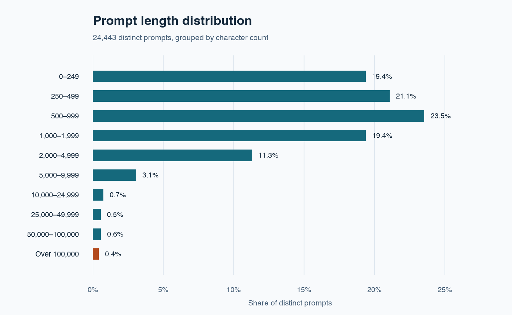
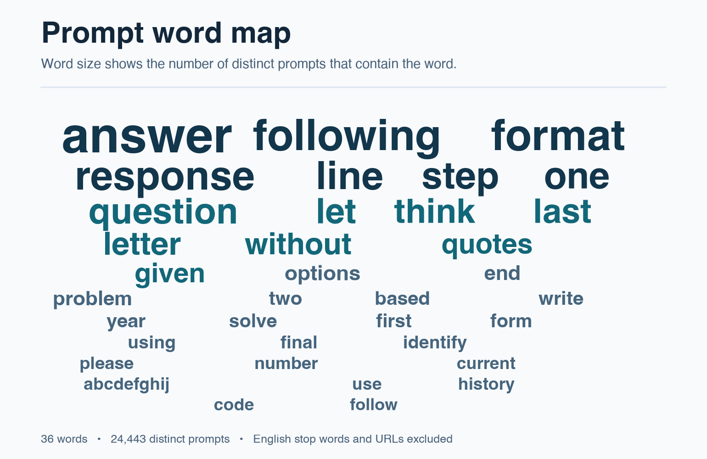

# LLMRouterBench dataset

The export contains **548,059 evaluation rows** and **24,443 distinct prompt texts**. The median distinct prompt contains **681 characters**. **102 prompts** exceed the Goldilocks input limit.

## Data source

| Item | Value |
| --- | --- |
| Upstream archive | `bench-release.tar.gz` |
| Archive SHA-256 | `b79f8cde1a6f029c2efa663a3a3b6f7748defb22341fe59f328cebef6648c8f1` |
| Local export | 700 JSONL files across 27 benchmark folders |
| Local export size | 6,507,129,966 bytes (6.51 GB) |
| Row fields | `index`, `origin_query`, `prompt`, `prompt_tokens`, `completion_tokens`, `ground_truth`, `raw_output` |

One row represents one model evaluation. Many models evaluated the same prompt. This report counts an exact copy of a prompt once when it reports distinct prompts. [Upstream dataset release](https://huggingface.co/datasets/NPULH/LLMRouterBench/tree/main)

## Prompt contents

- Every row has a nonempty `prompt`.
- The `origin_query` and `prompt` fields match exactly in **169,020 rows**. These rows contain **7,504 distinct prompts**.
- For the other **16,939 distinct prompts**, inspect both fields before selecting the input. Added text can contain answer-format instructions or context that the task needs.
- The three ArenaHard subsets repeat **750** prompts from the parent folder. Keep copies of the same underlying task together when you assign data splits.
- All **500** distinct SWE-bench Verified prompts contain an issue and file excerpts. **322** contain a GitHub repository URL. Use the issue and file markers to identify the sections.

## Prompt length

This report defines `prompt_length` as the number of Unicode characters in the full `prompt`, including spaces and line breaks. P95 is the 95th percentile. The export records `prompt_tokens` for each model run.

| Population | Unit | Count | Min | Mean | P25 | Median | P75 | P90 | P95 | P99 | Max |
| --- | --- | ---: | ---: | ---: | ---: | ---: | ---: | ---: | ---: | ---: | ---: |
| All export rows | Characters | 548,059 | 9 | 2,123.3 | 376 | 710 | 1,423 | 3,108 | 4,821 | 26,081 | 962,265 |
| Distinct prompt texts | Characters | 24,443 | 9 | 2,558.9 | 353 | 681 | 1,376 | 3,478 | 5,174 | 48,842 | 962,265 |
| Positive reported token counts | Tokens | 541,380 | 4 | 1,380.9 | 123 | 216 | 424 | 941 | 1,405 | 20,314 | 3,321,045 |

The token summary excludes **6,679 rows** without a positive integer token count. Use the character counts to compare text length across benchmark folders.

| Character band | Distinct prompts | Share |
| --- | ---: | ---: |
| 0–249 | 4,734 | 19.4% |
| 250–499 | 5,152 | 21.1% |
| 500–999 | 5,753 | 23.5% |
| 1,000–1,999 | 4,739 | 19.4% |
| 2,000–4,999 | 2,760 | 11.3% |
| 5,000–9,999 | 749 | 3.1% |
| 10,000–24,999 | 182 | 0.7% |
| 25,000–49,999 | 134 | 0.5% |
| 50,000–100,000 | 138 | 0.6% |
| Over 100,000 | 102 | 0.4% |

**94.7%** of distinct prompts contain fewer than 5,000 characters. SWE-bench Verified accounts for **55.6%** of the characters across distinct prompts. All **102** prompts above the router limit come from that suite. The router measures that limit in JavaScript UTF-16 code units. [Router input check](src/router.ts#L61)

### Length by benchmark folder

The length columns use distinct prompt texts within each folder. A prompt can appear in more than one folder.

| Benchmark folder | Rows | Distinct prompts | Median characters | P95 characters | Max characters |
| --- | ---: | ---: | ---: | ---: | ---: |
| aime | 2,280 | 60 | 597 | 913 | 1,264 |
| arc-agi | 6,800 | 400 | 2,978 | 9,947 | 16,961 |
| arcc | 23,440 | 1,172 | 432.5 | 664 | 1,111 |
| arenahard | 26,250 | 751 | 285 | 4,867 | 27,586 |
| arenahard_coding | 8,349 | 253 | 584 | 7,995 | 27,586 |
| arenahard_creative_writing | 8,250 | 250 | 188.5 | 3,035 | 10,306 |
| arenahard_math | 8,151 | 247 | 220 | 2,022 | 9,184 |
| bbh | 21,600 | 1,080 | 1,320 | 4,751 | 7,662 |
| emorynlp | 13,940 | 696 | 1,266.5 | 1,969 | 2,825 |
| finqa | 22,940 | 1,138 | 4,432 | 6,692 | 9,263 |
| gpqa | 7,524 | 198 | 781 | 1,462 | 5,839 |
| hle | 39,870 | 2,159 | 711 | 2,794 | 21,343 |
| humaneval | 3,608 | 164 | 994 | 1,856 | 2,631 |
| kandk | 14,000 | 700 | 899.5 | 1,108 | 1,188 |
| korbench | 25,000 | 1,248 | 3,389 | 7,658 | 12,892 |
| livecodebench | 40,090 | 1,055 | 1,832 | 3,101 | 4,530 |
| livemathbench | 4,235 | 121 | 450 | 769 | 1,079 |
| math500 | 10,000 | 500 | 421 | 785 | 2,006 |
| mathbench | 3,000 | 150 | 442 | 685 | 903 |
| mbpp | 19,480 | 974 | 322 | 576 | 4,389 |
| medqa | 25,460 | 1,273 | 1,022 | 1,553 | 3,843 |
| meld | 24,640 | 1,231 | 884 | 1,427 | 2,637 |
| mmlupro | 81,036 | 3,002 | 691 | 1,907 | 3,891 |
| simpleqa | 71,940 | 4,326 | 88 | 178 | 381 |
| swe-bench | 7,500 | 500 | 46,616.5 | 187,169 | 962,265 |
| tau2 | 3,336 | 278 | 705 | 1,513 | 1,740 |
| winogrande | 25,340 | 1,267 | 459 | 495 | 539 |

## Prompt word map

The map shows the 36 words that appear in the most distinct prompts. A repeated word counts once per prompt. Larger words occur in more prompts.

| Word | Prompts | Word | Prompts | Word | Prompts |
| --- | ---: | --- | ---: | --- | ---: |
| answer | 17,525 | without | 8,788 | form | 3,728 |
| following | 14,624 | quotes | 7,772 | using | 3,376 |
| format | 14,621 | given | 7,539 | final | 3,360 |
| response | 13,452 | options | 4,891 | identify | 3,315 |
| line | 12,777 | end | 4,552 | please | 3,175 |
| step | 12,199 | problem | 4,433 | number | 3,098 |
| one | 11,955 | two | 4,060 | current | 3,022 |
| question | 11,246 | based | 3,996 | abcdefghij | 3,002 |
| let | 10,847 | write | 3,913 | use | 2,992 |
| think | 10,416 | year | 3,899 | history | 2,986 |
| last | 10,404 | solve | 3,755 | code | 2,957 |
| letter | 9,660 | first | 3,729 | follow | 2,868 |

Words such as **format**, **last**, **letter**, and **quotes** reflect repeated benchmark instructions. During cleaning, check which instructions define the task and which instructions only serve the benchmark.

### Analysis method

1. Read every row from the seven-field JSONL export.
2. Group prompt texts by the SHA-256 hash of their exact UTF-8 bytes.
3. Measure character counts. Use the nearest rank for percentiles and average the two middle values for an even-sized median.
4. For the word map, remove HTTP and HTTPS URLs. Convert the remaining text to lowercase.
5. Count sequences of at least three ASCII letters. Exclude sequences next to an ASCII letter or digit. Exclude the common words listed below.
6. Rank by the number of distinct prompts that contain each term. Use alphabetical order for ties.

Common words excluded from the word map

a, about, above, after, again, against, all, am, an, and, any, are, as, at, be, because, been, before,
being, below, between, both, but, by, can, could, did, do, does, doing, down, during, each, few, for, from,
further, had, has, have, having, he, her, here, hers, him, his, how, i, if, in, into, is, it,
its, just, me, more, most, my, no, nor, not, now, of, off, on, once, only, or, other, our,
ours, out, over, own, same, she, should, so, some, such, than, that, the, their, theirs, them, then, there,
these, they, this, those, through, to, too, under, until, up, very, was, we, were, what, when, where, which,
while, who, whom, why, will, with, would, you, your, yours

## Redistribution review

The upstream MIT license covers original LLMRouterBench contributions within the contributors’ rights. Third-party material retains its source terms. [Bundled upstream license](https://huggingface.co/datasets/NPULH/LLMRouterBench/blob/main/LICENSE)

MELD includes dialogue from the EmotionLines corpus. EmotionX lists CC BY-NC-ND 4.0 for its release of that corpus. LiveCodeBench also includes problems from several contest platforms. The review could not confirm redistribution rights for the full seven-field export. [MELD project](https://affective-meld.github.io/) · [EmotionLines release terms](https://sites.google.com/view/emotionx2019/datasets) · [Creative Commons license](https://creativecommons.org/licenses/by-nc-nd/4.0/) · [LiveCodeBench sources](https://livecodebench.github.io/)

This report shares aggregate statistics and word frequencies. The full JSONL export stays in the local cache.
