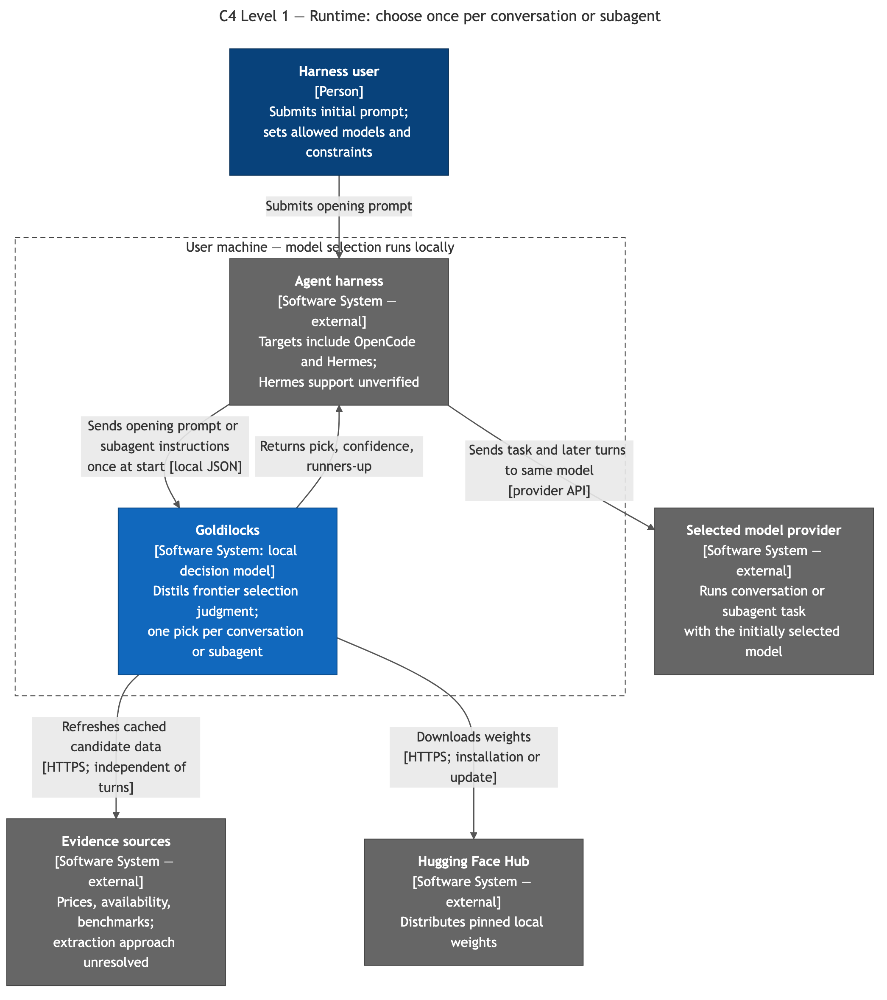
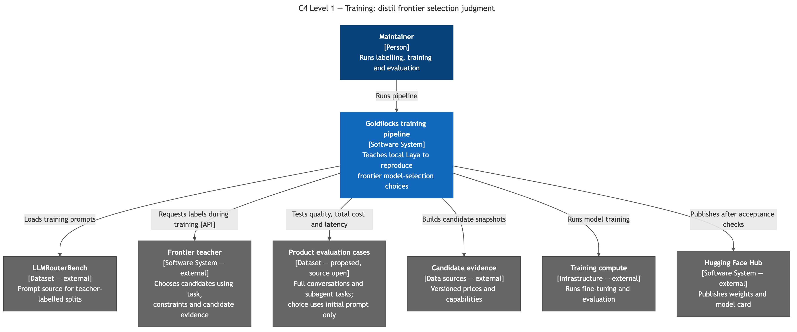
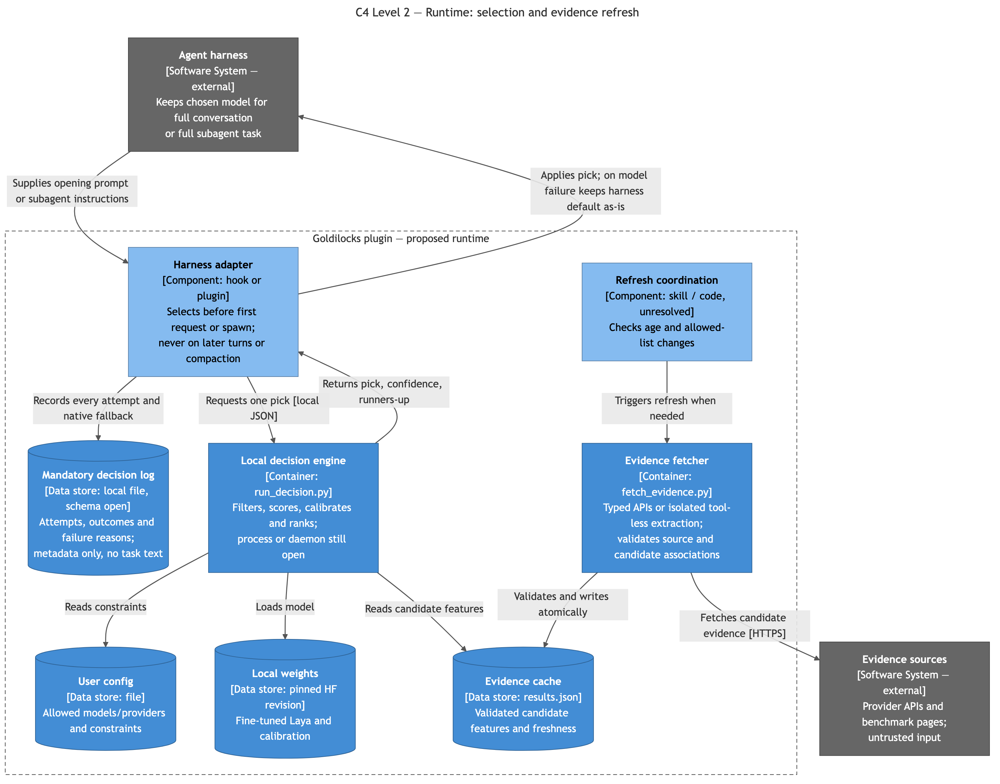
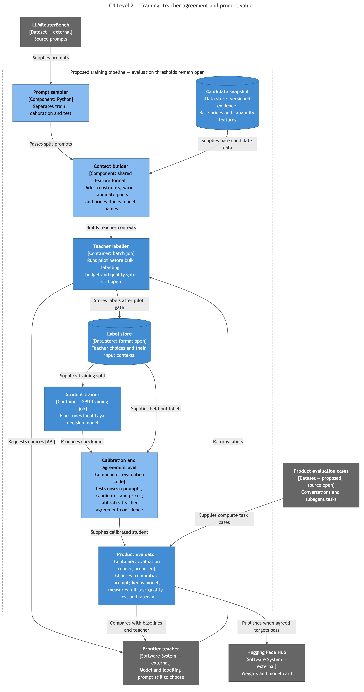
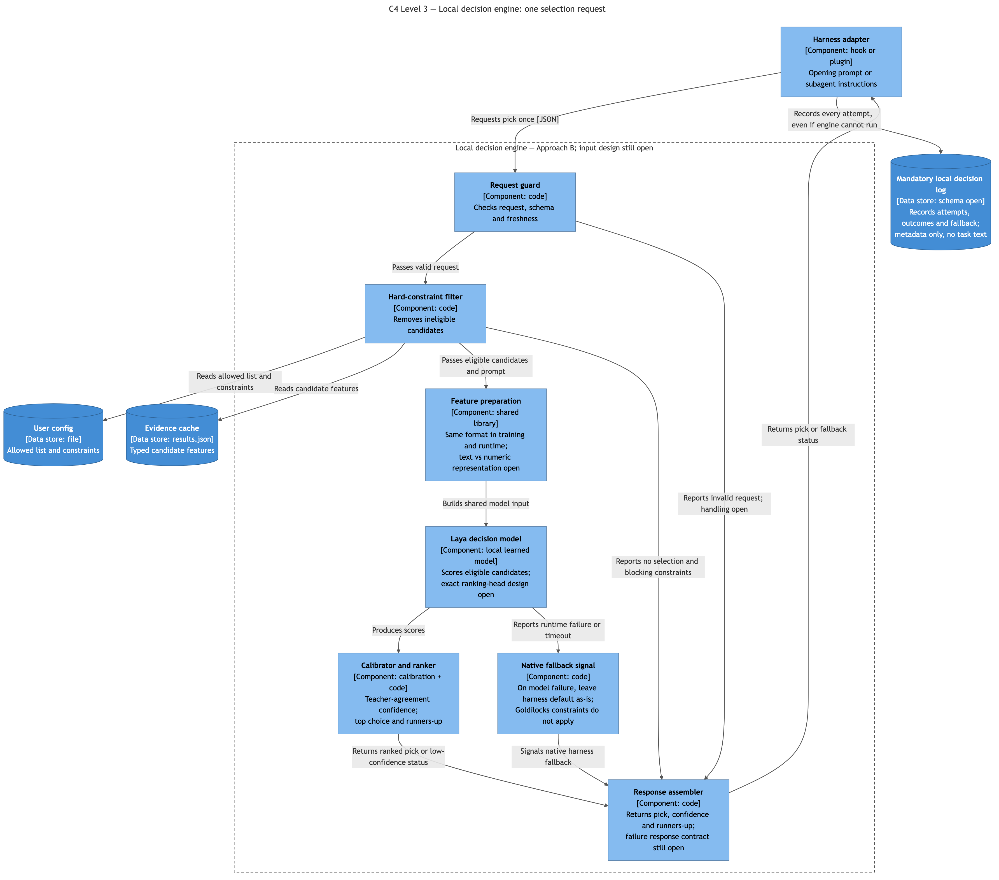
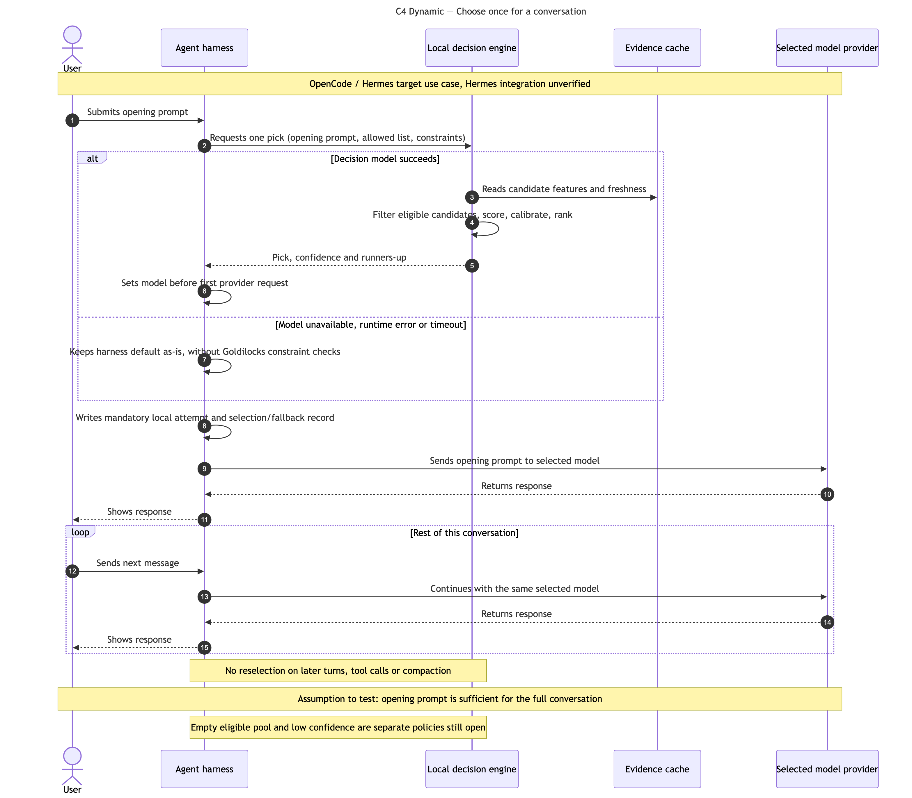
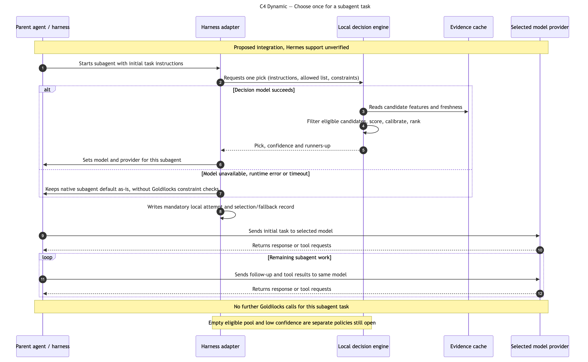

# Goldilocks: local model selection for conversations and subagents

* **Author:** mani2001
* **Date:** 2026-11-15
* **Document authority:** This brief supersedes conflicting content in `PLAN.md` and `../README.md`. PLAN §6.4 remains normative because this brief explicitly incorporates its price-variation test. Historical review snapshots preserve the earlier state.
* **Status:** Brainstorm brief; EGM stages 5–8 completed on 2026-11-16 with changes requested. See the [current consolidated review](consolidated_review_report.md). Stage 9 is not applicable until a detailed implementation plan exists.
* **Revision (2026-11-16):** Author-directed logging/fallback decisions and the accepted EGM resolutions are applied. See the [resolution record](goldfish_review_report.md) and the open questions below. The [reviewed snapshot](reviews/2026-11-16/inputs/concepts_brief.md) is preserved; the revised brief has not been independently re-reviewed.

## Overview

Goldilocks is a local decision model integrated with an agent harness. It selects a model once when a conversation or subagent task begins:

1. **Conversation start:** the user submits an initial prompt in a harness such as OpenCode or Hermes. Goldilocks uses that prompt, the available candidates and the user's constraints to select a model before the first model request. The conversation continues with that model; Goldilocks is not invoked again on each turn.
2. **Subagent start:** the parent supplies the initial instructions for a subagent's task to Goldilocks. The harness starts that subagent with the selected model, which stays fixed for that task. The parent delegates model selection to the local engine.

These are product requirements, not claims that both integrations already work. In particular, Hermes integration has not been verified here (see Risk 5). For either use case, Goldilocks returns:

1. **A pick:** one model *and* one provider (the same model can cost 2–15x more on one provider than another).
2. **A calibrated confidence score** for that pick.
3. **Runners-up:** the next-best candidates under the *same* constraints.

**Core assumption:** the initial user prompt or subagent instructions contain enough information to choose a suitable model for the whole conversation or task. Later turns may introduce different demands; evaluation must test the consequences of keeping the initial choice fixed.

The decision is made by a small local model: **Laya** (`convaiinnovations/laya-typed-decisions`, a ModernBERT-large encoder plus a decision head, 421M parameters), fine-tuned to rank candidates. It is trained to reproduce the picks of a large frontier "teacher" model at a small fraction of the teacher's cost per decision. The teacher sees the task plus each candidate's price, capability and cost-per-task features, and its pick is the training label. All training, validation and test data come from **LLMRouterBench** prompts labelled by that teacher.

**Why a learned local engine:** pay for frontier judgment while creating training labels, then aim to reproduce that judgment locally at a fraction of the teacher's per-decision cost. This removes manual model selection for the user and aims to reduce the parent's model-selection reasoning and delay. The product goal is better selections and better task results per dollar. Teacher agreement measures how well the student copies the teacher; actual task outcomes, total cost and latency must establish whether that copying delivers the intended benefit.

The plugin does not search the web on each decision. It ships two scripts:

1. **`fetch_evidence.py`** collects current prices, availability and benchmark data from a fixed list of sources into `results.json`.
2. **`run_decision.py`** takes the initial conversation prompt or subagent task instructions, `results.json` and the user's allowed-model list, and prints the pick.

A harness integration calls `run_decision.py` once before the conversation's first model request or once before each subagent starts. The parent still writes the subagent's task instructions; the local engine handles candidate comparison. No later turn, tool call or compaction automatically invokes selection again. A skill and the scripts refresh `results.json` when it is older than its time-to-live (default 24 h) or when the user changes their allowed list.

**Model failure and logging:** if the local decision model fails, the harness uses its normal default as-is, even if that default does not meet Goldilocks task constraints. Every selection attempt and fallback is logged locally. See Risk 7 and G2/G6 for the boundary.

**Target user:** a harness user who wants to submit a task without choosing its model, or a developer whose parent agent delegates work to subagents. Goldilocks aims to allocate enough capability for the work at an appropriate cost.

### Architecture at a glance (C4)

The diagrams reflect the 2026-11-16 clarification: select once at conversation start or subagent start, then keep that model. They describe the proposed design, with unresolved integration, evidence and evaluation choices labelled explicitly; Hermes support remains unverified.

**Level 1: system context at runtime.** Goldilocks selects locally on the user's machine without sending the prompt to a routing service. The harness then sends the conversation or task to the chosen model provider. Goldilocks accesses the network for evidence refresh and weight downloads.

**Level 1: system context for training.** Training is a separate system. The teacher and the GPU appear here only. They are never called when a decision is made at runtime.

**Level 2: containers at runtime.**

**Level 2: containers for training.** The feature serialiser is shared: training and runtime must build model inputs in exactly the same way, or the model reads inputs at runtime that differ from what it was trained on.

**Level 3: components inside the decision engine.** Hard constraints are applied in code *before* the model scores anything, so the model cannot pick, or list as a runner-up, a candidate the user cannot use.

**Dynamic view: one conversation.** Choose from the opening prompt before the first provider request; later turns continue with the same model.

**Dynamic view: one subagent task.** Choose from the parent's initial instructions; subsequent tool calls and follow-ups use the same model.

Diagram sources (Mermaid) are in `diagrams/src/`.

## Analysis

### Arguments from the 2026-11-15 team discussion, with author clarifications

The team discussed the open questions on a call. Each argument below gives the verdict and the reason. S3 and S7 include the author's 2026-11-16 clarification. Where a verdict depends on something not yet checked, it says so.

**S1. Will the student just copy the training set's pick distribution, or adapt when prices change?**
*Verdict:* Including price as an input feature is necessary but not enough, and an ordinary held-out test set will not catch the problem.
- **Why price alone is not enough.** If every label is made from one price snapshot, each model has exactly one price in the whole training set. The price column then carries the same information as the model's name. The student can reach full accuracy by learning "this candidate usually wins" and ignoring price.
- **Why the test set won't catch it.** A held-out test split drawn from the same snapshot has the same prices, so the shortcut scores perfectly there too. The objection that "the test set catches overfitting" is right in general but fails here, because train and test share the same price-to-model pairing.
- **What to do instead.** Teach price sensitivity through counterfactual labelling:
  - When building teacher contexts, randomly rescale prices, and to a lesser degree capability scores, per example.
  - Hide or randomise model names.
  - Vary which candidates appear in each pool.

  The teacher then sees, for example, Sonnet both cheap and expensive, and its labels show how the pick should change.
- **Required price-variation test.** Follow [PLAN.md §6.4](PLAN.md#64-price-variation-test-added-2026-11-16-required-before-release): freeze the student, task and non-price features; vary input/output prices, including provider price reversals; recompute derived costs; and compare against fresh teacher choices and code-based scoring. Measure both appropriate changes and appropriate unchanged picks. Test unseen candidate/provider pools separately. Keep price variants grouped by base prompt in held-out splits. Require zero constraint violations and zero higher-cost picks among otherwise identical options; freeze remaining acceptance thresholds before the final run. Each price variant is a new selection-at-start scenario, not mid-conversation routing.

**S2. "Calibration on 50 dev tasks is noisy."**
*Verdict:* This objection no longer applies. It assumed the 100-task set, which has been dropped. LLMRouterBench has about 24k prompts, which is enough for a separate calibration split. The meaning of confidence still holds: it is the probability the teacher would make the same pick. The team accepts that as the claim, on the grounds that "we rely on the frontier model's decision."

**S3. If the teacher's decision is the ground truth, why not just let the frontier orchestrator decide?**
*Author clarification (2026-11-16):* Approach B remains the chosen engine. Train a small local model to reproduce a frontier teacher's selection judgment, then invoke it once at conversation start or subagent start.
- **For the user:** submit the opening prompt and let Goldilocks choose the model for the conversation.
- **For the parent agent:** supply the subagent's task instructions and delegate model selection, reducing the reasoning and time spent comparing candidates.
- **Why distil the teacher:** teacher calls are paid during label creation; runtime selection uses local inference. Matching the teacher at a fraction of its per-decision cost is the target, not a measured result yet.
- **What must be compared:** teacher agreement, completed-task quality, total conversation or subagent cost, and selection latency against simple baselines and direct teacher selection. Include local inference overhead and report training/setup cost separately when estimating break-even. Use one named frontier teacher and consistent prices; the old Day 0 teacher rate does not establish frontier-teacher economics.
- **Product claim to validate:** better model selections and better task results per dollar, with one selection per conversation or subagent task.

**S4. Live web search on every decision, or a cached snapshot?**
*Verdict:* Use a cached snapshot. The argument that a 5–20 s delay is acceptable is about latency, but latency is not the main reason. The evidence (prices, availability, benchmark scores) is the same whatever the subagent's task is, so searching on every spawn fetches the same data hundreds of times a day. What depends on the task is the matching of task to candidate, and that is the student's job. The team reached the same conclusion on the call ("never use search, use extract"). The file is **`results.json`**, not `.md`; both sides agreed on that during the call.

**S5. Does the orchestrator still need a reasoning loop to turn evidence into model input?**
*Verdict:* Not on each decision.
- **At conversation or subagent start:** the harness passes the initial prompt straight to `run_decision.py`, which reads the typed `results.json`. No generative LLM reasoning step is required for selection.
- **When `results.json` is refreshed:** a reasoning step is needed only if a source returns unstructured HTML. Then an LLM extracts numbers once per refresh, and the extracted values must pass checks before they are written:
  - range checks;
  - comparison with the previous snapshot (flag price changes over 50%);
  - every model in the allowed list is present;
  - source, candidate and benchmark associations pass the S6 validation contract.

  Structured APIs need no LLM step at all.

**S6. Where does benchmark data come from: the Artificial Analysis API key, a general scraper (Tavily/Exa extract or crawl), or many benchmark sites such as Vals?**

This was the main argument on the call. *Team verdict (end of call):*
- **Artificial Analysis is the primary benchmark source.** The team agreed it is the most widely trusted index because it runs every model through its own harness.
- **Extract, never search.** A search query returns blog posts and opinion pages. Goldilocks only needs benchmark numbers, so the fetch step extracts or crawls a fixed **allow-list of pages**. The list starts with every Artificial Analysis page the feature schema uses (each tab, such as each domain index, is its own URL). Other benchmark pages, such as Vals, can be added to the list.
- **One crawler key, not one key per source.** Requiring a separate Artificial Analysis API key was rejected as too much setup for the user. Any extract or crawl provider (Tavily, Exa or another) can read any page on the list, so the user configures one key.
- **Cache per URL, convert once per refresh.** The evidence-refresh path converts unstructured pages through a separate tool-less extraction call. The call receives only the fetched page, its source identifier, the required schema and candidate identifiers. It receives no conversation/subagent prompt, conversation history, credentials or authority to invoke tools. Fetching code handles credentials outside the model input. This is separate from the active harness conversation and runs once per refresh, not per selection. Structured APIs bypass the extraction model.

*Constraints the team verdict must still meet (from review):*
- **Data sources are fixed when the model is trained.** The student learned from features built from specific sources through the capability mapping. A score scraped from Vals at runtime does nothing unless the mapping includes it, and changing the mapping changes the inputs the student sees. So "support any benchmark site the user trusts" is not something runtime scraping can deliver. Adding a source is a schema change: update the mapping, version it, and check it against the eval set.
- **Extracted numbers must be checked before they are written.** Extracting numbers from page text with an LLM can copy a number wrongly with no visible error. Every refresh runs the S5 checks and the source/candidate/benchmark association checks below. Prices and availability need no crawling: each provider's model-list API (OpenRouter `/api/v1/models`, which is public, and each other provider's `/v1/models` with the key the user already has) returns typed data.
- **Optional: a published snapshot.** The maintainers could run the fetch step daily (for example, in GitHub Actions) and publish `results.json`, so most users need no crawler key at all. *Unverified:* whether Artificial Analysis's terms allow redistributing its numbers. The OpenRouter benchmarks API seen on the call is a possible typed source; its access terms are not yet checked.
- **Untrusted text stops at extraction.** The extraction model reads page text as untrusted data. Only validated typed features reach the local decision model; page text and extraction instructions do not enter the active conversation or parent agent context. Before accepting an extraction, validate source URL, model/provider identity, benchmark name and version, units, required-field coverage and numeric ranges. Reject ambiguous associations and keep the last valid snapshot on refresh failure. Extractor model choice and hosting remain open; if remote, only this bounded public-page extraction input may leave the machine.

**S7. Main agent or subagents?**
*Author clarification (2026-11-16):* both are intended use cases, with one selection at the start of each conversation or subagent task.
- **Main conversation:** use the initial user prompt to choose a model before the first request, then keep it for the rest of the conversation. Do not reselect on later turns or after compaction. OpenCode and Hermes are the author's example target harnesses; Hermes support is unverified.
- **Subagents:** the parent supplies the initial task instructions to the decision engine; the returned model runs that subagent's task without further selection calls.
- **Assumption to test:** opening instructions are sufficient for the full conversation or task. Evaluate later changes in task demands while keeping the original selection fixed.
- **Harness constraint:** the earlier Claude Code spike found that a prompt-submit hook cannot change the session model. That harness would need a launcher to pick before starting the session (Risk 5).

**S8. How is this different from OpenRouter's router or gateway routers (Vercel, LangSmith, others)?**
Goldilocks targets a specific combination: local fine-tuned Laya selection from the opening prompt, a fixed model for the conversation or subagent task, hard constraints on Goldilocks picks, and teacher-agreement confidence with runners-up. These are requirements to validate, not proven unique capabilities. Existing routers overlap; the bounded comparison below identifies useful baselines and integration candidates. No tool was installed or benchmarked for this comparison. See the comparison in Alternatives Weighed.

### Review findings

The risks below distinguish accepted requirements from untested assumptions about labels, harness integration, local runtime and changing candidate pools.

### Blocking risks

**1. The teacher is unproven, and nothing checks picks against real results.**
In this design, "correct" means "agrees with the teacher". On Day 0, the prompted teacher (Qwen3-235B) made exactly the same picks as the simple rules engine. LLMRouterBench's measured results cover 33 older models, none of them current candidates. So once teacher labels replace them, the dataset supplies prompts only. Dropping the 100-task set removes the last link to real task success. A student trained on a teacher can at best equal that teacher on the teacher's own labels. Hitting every accuracy target would still say nothing about whether the picks are good.
*Mitigation:*
- **Gate the teacher before bulk labelling.** Run it on a pilot of about 200 prompts first. For a subset, actually run 3–4 current candidates and score their answers with the dataset's answer key. Separately, check the teacher's picks among the 33 older models against LLMRouterBench's measured best for those prompts.
- **What passing means:** the teacher must clearly beat `rules_engine.py`, and a human spot-check of about 50 items must agree with it.
- **If you skip the gate**, the brief must state the only claim plainly: "Goldilocks matches teacher X at Y% of its cost."

**2. What the confidence number means.**
Calibrated against teacher labels, confidence 0.8 means "80% chance the teacher would agree", not "80% chance this model completes the task". Users will read it as the second. There are also three mechanical problems:
- One temperature is fitted on one snapshot of the candidate pool, and it drifts when `results.json` refreshes.
- Removing candidates with the hard-constraint mask changes the probability distribution after calibration.
- "RLCD" in PLAN.md is never defined.

*Mitigation:*
- V1 confidence estimates the probability that the named teacher, under the fixed labelling protocol and the same task, eligible candidates, features and prices, would choose the selected candidate. It does not estimate task success or cost optimality.
- Fit calibration after the hard-constraint mask using a separate calibration split. Report ECE, Brier score and reliability diagrams; freeze numerical thresholds before final testing. Test calibration on changed prices and held-out pools, and define refresh/recalibration triggers.
- Evaluate runners-up separately: hard-constraint compliance and top-k recall of the teacher's winner. These metrics do not validate the ordering among non-winners. Use a bounded pilot with ranked teacher preferences or measured outcomes if claiming that ordering is useful; richer labels are an experiment, not a prerequisite for top-1 agreement calibration.

**3. The candidate pool changes; name shortcuts and input length need tests.**
B puts the task and every candidate (name, prices, scores, all as text) into one sequence of at most 1,024 tokens. Two problems follow:
- **Name memorisation.** The model may learn shortcuts like "Sonnet usually wins" instead of reading the features. When `results.json` refreshes with new models or prices, it meets inputs it never saw in training and gives no warning.
- **Length.** About 20 candidates plus a long subagent prompt will not fit in 1,024 tokens.

PLAN.md also contradicts itself: §3 scores each (task, candidate) pair separately, while §3.3 reads all candidates in one sequence.

*Mitigation, staying within B:*
- **Compare a task encoder with numeric candidate features.** Laya would encode the task once and a learned head would score unnamed, normalised candidate vectors. This can reduce candidate text and remove explicit model-name features; task length, pool-size cost, feature shortcuts, unseen candidates and price changes still require tests. Compare it with the text-based forms before choosing the input structure.
- **If the single-sequence form stays**, use these training defences:
  - strip names;
  - shuffle candidate order;
  - add small random changes to prices and scores;
  - train on random subsets of the pool;
  - test on candidates held out from training, with a pass threshold.
- **One versioned input-format definition** shared by labeller, trainer and runtime. The engine refuses to run if the format version does not match.

**4. Training prompts may not represent full conversations or subagent tasks.**
LLMRouterBench is short, single-turn academic questions (maths, QA, code puzzles). Subagent prompts are long, multi-step, use tools and carry repository context. Most of a subagent's cost comes from tool loops, which LLMRouterBench does not exercise. A model that scores well on the LLMRouterBench test split may still pick badly for real subagent prompts.
*Mitigation:*
- Build an evaluation set of 100–300 realistic subagent prompts, such as SWE-bench/SWE-Gym task statements, or LLMRouterBench items rewritten into subagent style that keep their answer keys.
- Pass the subagent type (explore, plan, implement, review, test) as a structured input.
- Evaluate conversation-start selection using only the opening prompt to choose, then measure quality and cost over the full conversation with that choice fixed. Include conversations whose demands change after the opening turn. The source and acceptance thresholds for this evaluation remain open; LLMRouterBench teacher agreement alone does not test this assumption.

**5. The harness hook points are partly verified (Claude Code spike run 2026-11-15; other harnesses below).**
The two use cases require access to the initial prompt and the ability to set the model before the first conversation request or subagent request. The historical spike evidence below does not establish support in every harness.
- **Hermes:** added as a target example in the author's 2026-11-16 clarification. No integration spike is recorded here; both selection paths need verification.
- **Claude Code 2.1.322, tested by running it.** Evidence is the per-model billing (`modelUsage`) in `claude -p --output-format json`, not the model's own report.
  - *Subagent hook: works, with a limit.* A `PreToolUse` hook on the `Agent` tool receives the subagent's full prompt and can return a changed `updatedInput`. Rewriting `model` from `sonnet` to `haiku` moved the subagent's billing from Sonnet to Haiku. But the `model` field accepts only four aliases: `sonnet`, `opus`, `haiku`, `fable`. A full ID (`claude-haiku-5-5`) or a gateway ID (`openai/gpt-6.1-terra`) fails schema validation, and the spawn errors.
  - *Way around the limit: works.* The hook can instead rewrite `subagent_type` to a Goldilocks agent file whose frontmatter sets `model:` to a full model ID. The subagent was billed as `claude-haiku-5-5` from that file. Costs of this route: the plugin must write one agent file per candidate model, and rerouting replaces the requested agent's system prompt and tool limits (an `Explore` agent would lose its read-only tools) unless the plugin also writes one file per agent type and candidate.
  - *Non-Anthropic models: not tested.* Claude Code sends all requests to one base URL fixed at process start (`ANTHROPIC_BASE_URL`, for example OpenRouter). A gateway model ID in an agent file should then route through that gateway, but this was not run. Choosing a different *provider* per subagent would still need a local proxy or the gateway's own provider routing.
  - *Main-session hook: does not work.* A `UserPromptSubmit` hook fires before the first request and can inject text: its `additionalContext` reached the model (verified). It has no output field for the model. Writing `model` into `.claude/settings.local.json` from the hook did not change the model for that turn or for a later turn in the same live session; only a new process picked it up. The tested prompt-submit hook did not change the live session model. A launcher selecting before process start or an explicit user model switch are candidate paths; this spike does not rule out all other switching mechanisms.
- **OpenCode 2.2.3.** Has native subagents (the `subagent` tool, input `{agent, description, prompt, model}`, where `model` is `providerID/modelID`). *Subagent hook:* the source shows a plugin hook (`execute.before`) that sees the plaintext prompt and can replace the input, including a cross-provider model; OpenCode's own built-in plugin does this. Not run end to end, because no working OpenCode credential was available. *Main session: works (run).* A `prompt` hook called `switchModel` and the outgoing request used the new model and provider. *Injection: works (run).*
- **Codex 0.169.0.** Has native subagents (`spawn_agent`, per-agent `model` in `.codex/agents/*.toml`). *Subagent hook: half works (run).* A `PreToolUse` hook on the spawn tool set `updatedInput.model`, and the subagent ran on that model while the parent kept its own. But the subagent's prompt reaches the hook encrypted, so Goldilocks cannot read the task it is picking for, and there is no provider field. *Main session: does not work (run).* `UserPromptSubmit` ignores a `model` output. *Injection: works (run).*
- **Pi 0.87.1.** No built-in subagents; an example extension spawns child `pi --model X` processes, so Goldilocks would ship its own subagent tool. *Hooks: work (run).* An `input` hook ran an external command and called `setModel()`, switching provider and model before the first request; the same hook can rewrite the prompt. Since each subagent is a full `pi` process, this hook also covers subagents (by mechanism; not run as a subagent).
- **Spike verdict.** OpenCode is the best first harness: native subagents, one hook that sees the plaintext prompt and sets provider and model, and a main-session switch. Pi's main-session path was tested; its proposed subagent path needs its own tool and an end-to-end test. Claude Code works for subagents through generated agent files, but the tested UserPromptSubmit path could not switch the live session model and is limited to one gateway per process. Codex can force a subagent's model but cannot see the prompt, which blocks Goldilocks there.
- **Main session.** The revised scope selects once before the first request and keeps that model throughout the conversation. No automatic mid-conversation switch is planned.

*Mitigation:*
- Finish the two untested paths: OpenCode's subagent hook end to end with a working key, and a Claude Code agent file with a gateway model ID through OpenRouter.
- Confirm OpenCode as the first harness once its subagent hook is verified.
- Verify that the conversation-start integration selects before the first request and does not run again on later turns or compaction. Verify Hermes separately before claiming support.

### Major risks

**6. The rationale for B is stated; its benefits remain unmeasured.** The author retains fine-tuned Laya to provide local access to a frontier teacher's model-selection judgment at lower per-decision cost. It removes manual selection at conversation start and delegates selection away from the parent at subagent start (S3, S7). The remaining question is how much teacher agreement, task quality, total cost and latency it achieves. Compare against simple selection baselines and the actual frontier teacher. The Day 0 Qwen3 price cannot establish the cost of that teacher. Account for training/setup costs separately, and do not assume that one selection per conversation produces the same savings as frequent routing.

**7. Native harness fallback is decided; other failure cases need a contract.**
*Author decision, 2026-11-16:* if the local decision model is unavailable, times out or fails to run, the harness continues with the default it would normally use for that conversation or subagent. Goldilocks does not substitute a rules engine, call a frontier selector or require a separately configured fallback. The author explicitly accepts use of the harness default as-is even if it violates Goldilocks task constraints. Record this as a fallback, not as a validated Goldilocks pick.

An empty eligible set returns a visible no-selection result and identifies the blocking constraints. It does not launch a model or trigger native fallback merely because no candidate is eligible. This differs from decision-model unavailability, runtime error or timeout, which uses the harness default as-is. The remaining failure table must cover:
- model unavailable, runtime error or timeout: native harness default as-is (decided);
- `results.json` is missing or corrupt;
- every candidate is removed by the mask: return no selection, log infeasibility, and notify the user;
- confidence is low;
- the provider returns 404 or 429;
- the harness ignores the pick.

Write a table with one row per failure: the action, mandatory log record and user notification. A decision-model failure must not prevent the harness from proceeding with its normal default.

**Logging is mandatory, not opt-in.** The harness integration records every selection attempt and decision-model failure/fallback locally, including failures where the model cannot write its own log. Logging does not authorize remote telemetry or automatic transcript archiving. V1 records decision metadata, not raw opening prompts, subagent instructions, model outputs or transcripts. It does not collect production outcomes for automatic learning. The retention/deletion period and behavior when the local log cannot be written remain explicit decisions required before implementation. A failed write must be surfaced and must never be reported as a successfully logged attempt. The accepted model-failure fallback must still let the harness proceed with its default; any unavoidable missing record is a logging failure, not an exemption from mandatory logging. The record must identify:
- input metadata limited to request kind, input length and candidate identifiers before/after the mask when available; exclude task text and arbitrary user-supplied strings;
- the top probabilities when a model result is available;
- a hash of the weights;
- the `results.json` date;
- latency;
- whether Goldilocks selected a model or the harness used its default, the failure reason when applicable, and the model that actually ran.

**8. Making `results.json` refresh reliably. S4–S6 chose a cached JSON refresh path; source coverage and publication remain subject to validation.**
- Give `results.json` a schema version and typed fields; it is the only file the engine reads. If humans need a readable view, generate it from the JSON.
- Have code, not the agent, check the file's age and whether the allowed list has changed. If the file is stale, serve the pick from the old file and refresh in the background.
- Write refreshes atomically and keep the last few versions.
- Treat 404 and 429 errors as a trigger to refresh.
- Use the isolated extraction boundary and validation contract in S6.

**9. Installation and latency are not specified.**
- CPU latency, memory and installation footprint are unmeasured for the intended runtime. Specify hardware, precision, task length, candidate count and cold/warm conditions before quoting performance.
- Benchmark a process per call and a resident process, and compare supported full-precision/quantized runtimes on named Apple Silicon and x86 hardware. Measure cold/warm latency, memory and quality before selecting packaging, timeout and target. Defer shared multi-harness daemons and decision caching until a workload justifies them. Pin weights and input-format versions in every option.

**10. The frontier-teacher labelling budget must be calculated.** The historical Qwen estimate does not establish the cost of the selected frontier teacher or the larger training scope. Estimate prompts × profiles × variants × samples × input/output tokens at named teacher/provider prices, with retries and pilot costs separate. Select the teacher and a hard spending cap before bulk labelling; use a bounded pilot and a learning curve to decide whether more labels are worthwhile. No spend is authorised by this estimate.

**11. Constraints and "cost per task" are undefined.** LLMRouterBench has no constraints, so budget, latency and context profiles must be generated. Define:
- a fixed vocabulary for constraints;
- which constraints are hard (applied as a mask in code) and which are soft (features the model weighs);
- what to return when nothing is feasible: code reports which constraint blocked every candidate;
- the cost-per-task formula and where its token estimates come from.

**12. "Provider" has several meanings.** It can mean the company hosting the model, OpenRouter's upstream host, the harness's backend, or a "Fast" price tier. Define it once and keep one registry of IDs. A model-first/provider-second lookup is an alternative to joint model-provider scoring. It is acceptable only if provider prices, availability and constraints are accounted for when comparing models; otherwise it can change the best-value pick. Compare these designs using PLAN §6.4. Do not assume it halves the pool or removes the need to learn price sensitivity.

**13. Licences and data provenance.** Check the licences and provenance of the LLMRouterBench source datasets and the terms for extracting and redistributing each evidence source, including Artificial Analysis. Record the results in a data card before publication. A published evidence snapshot is optional and not approved until the relevant permissions are established.

### The trade-offs underneath, and the best outcome

| Conflict | How to remove it |
|---|---|
| A fixed local model vs. a candidate pool and prices that keep changing | Compare text candidates with unnamed numeric features; use counterfactual training and held-out pool/price tests. Input structure remains open. |
| Cheap labels at scale vs. knowing the labels are right | Gate the teacher on a measured pilot; test richer labels in the bounded runner-up experiment (Risk 2). Measure task outcomes in the explicitly scoped evaluation; production feedback learning remains out of scope. |
| Ready-made academic prompts vs. relevance to conversations and subagents | Use LLMRouterBench for the bulk of training. Test realistic subagent instructions and full conversations whose model is chosen using only the opening prompt. |
| Calibrated confidence vs. a label that means little | Confidence predicts teacher agreement under the fixed labelling protocol. Near-optimal cost-adjusted choice is a different, unselected target requiring outcome labels. Low-confidence action remains open. |
| Local selection vs. model failure | Continue with the harness default as-is and record the fallback locally; Goldilocks constraints do not govern this native fallback. |
| One initial model choice vs. evolving task demands | Keep the initial choice fixed for the conversation or subagent task; measure how often later demands make that choice unsuitable. |

**Best outcome (Ideal Final Result):**
- At conversation or subagent start, the harness calls the local engine once with the initial prompt and constraints; the chosen model handles the remaining conversation or task.
- Selection meets a latency target established on named reference hardware; runtime packaging remains open.
- Code masks hard constraints; the model/provider representation remains subject to the input-design comparison.
- It returns a pick, an honestly labelled confidence, and runners-up under the same constraints.
- Adding a model requires compatibility and held-out-candidate checks; retraining may be needed. If the decision model fails, the harness continues with its own default and logs the fallback.

## Goals vs. Non-Goals

* **In-scope goals (v1):**
  * **G1.** In the first supported harness (chosen by spike), select once before a conversation's first request and once before each subagent starts. Return pick (model + provider), calibrated confidence, and *k* runners-up under the same constraints, within a measured latency budget. Keep the choice fixed for the conversation or subagent task.
  * **G2.** Every Goldilocks-selected model and runner-up satisfies the hard-constraint mask in code. **Accepted exception:** on decision-model failure, the harness uses its normal default as-is; Goldilocks does not check or guarantee that default against its task constraints. Log the exception as native harness fallback.
  * **G3.** Agreement with the teacher on held-out LLMRouterBench data: top-1, top-3, and the cost of a wrong pick. Report it on held-out *prompts*, held-out *datasets* and held-out *candidates*, with a stated ECE target. Pass the required price-variation evaluation in PLAN.md §6.4, reporting changed-pick and unchanged-pick cases separately.
  * **G4.** On the same splits, beat: `rules_engine.py`; a fixed subagent-type → model-tier map; a feature-only gradient-boosted or logistic model; plain ModernBERT-large; and frozen Laya embeddings with nearest-neighbour lookup.
  * **G5.** Work offline after install. Evidence refresh is atomic, keeps the last good file on failure, and is enforced by code.
  * **G6.** On decision-model unavailability, runtime error or timeout, let the harness use its normal default as-is. Log every selection attempt and fallback locally; logging is mandatory. An empty eligible set returns no selection and identifies blocking constraints. Handling of low confidence and unfamiliar inputs remains part of the failure-policy decision.
  * **G7.** Publish weights and a model card on Hugging Face, pinned by revision.
  * **G8.** Demonstrate better selections and better completed-task quality per dollar against stated baselines. Measure total conversation/subagent cost, selection overhead and latency separately from teacher agreement. Test the opening-prompt sufficiency assumption over full conversations; evaluation sources and thresholds remain to be chosen.
* **Out-of-scope non-goals (v1):**
  * Live web search on each decision.
  * `fit_score`, `evidence_sufficient`, `reasons[]`, `warnings[]`, relaxed-constraint alternatives, `unconstrained_pick`.
  * Automatic reselection during a conversation, including after compaction; per-turn invocation of the decision engine.
  * Harnesses beyond the first one.
  * Learning from production outcomes and remote telemetry. Mandatory local decision logging remains in scope.
  * Routing inside a subagent (per turn or per tool call); a reasoning-effort dial; safety-aware routing.
  * Hugging Face demo Space; the custom 100-task evaluation set.
  * Publishing derived datasets before the licence check passes.

## Alternatives Weighed

* **A. Transparent scoring function with margin-based confidence.** It masks hard constraints, weights capability match by cost per task, and calibrates confidence from the score gap between first and second place. *Not selected for v1; retained as an evaluation baseline.* Trade-off accepted: B's learned interactions in exchange for training and runtime cost. Keep A as an evaluation baseline. Its earlier proposed runtime fallback role is superseded by the author's native harness-default decision.
* **B. Local decision model distilled from a frontier teacher.** *Selected; rationale clarified by the author on 2026-11-16.* Learn the teacher's task-to-model choices, then select locally once at conversation or subagent start. The intended benefits are better selections, less manual or parent-agent selection effort, and better task results per dollar. Training and local runtime costs are accepted design costs; agreement, actual task value and latency still require measurement. The exact input structure remains open (Risk 3).
* **C. The harness LLM picks from structured evidence.** *Not selected for v1; retained as an evaluation baseline.* Trade-off accepted: a local model with no per-call API cost, in exchange for losing C's zero training cost and free explanations. On Day 0, C made the same picks as the rules engine, and its stated confidence is not calibrated. Keep C as an evaluation comparison. Runtime LLM escalation is not adopted; decision-model failure uses the harness default.
* **D. Encoder maps task to capability needs; a separate ranker scores candidate features.** Not selected as a separate v1 architecture. Its explicit capability-needs intermediate differs from a B variant that directly learns scores from a task embedding plus numeric candidate features. The record does not supply a technical rejection rationale for that B variant; compare representations under Risk 3 rather than declaring the hybrid rejected or guaranteed to solve drift.
* **Live web search on every decision.** *Not selected:* at the rate subagents are started, a few seconds and an API cost per decision is too much. Replaced by the cached `results.json`.
* **The custom 100-task dev/test set.** *Not selected:* LLMRouterBench is the only source for train, validation and test. Review agents note it was the only set with constraints and success criteria, and suggest reusing it as a small measured-outcome check (see Risk 1).

**Existing routers — bounded documentation comparison, checked 2026-11-16.**

| Option | Documented overlap | Goldilocks fit and possible reuse |
|---|---|---|
| [OpenRouter Auto Router](https://openrouter.ai/docs/guides/routing/routers/auto-router) | Hosted per-request model/effort selection, allowed-model and provider restrictions, prices and benchmarks; can change models on later turns. | Useful hosted comparison. Its documented request path differs from local, once-at-start selection. Do not claim it lacks constraints or benchmark inputs. |
| [Not Diamond](https://docs.notdiamond.ai/docs/what-is-model-routing) | Pretrained and custom routers; quality/cost/latency trade-offs over candidate models. | Useful custom-router comparison. The overview alone does not establish local offline operation or Goldilocks confidence semantics; those remain unverified, not unsupported capabilities. |
| [RouteLLM](https://github.com/lm-sys/RouteLLM) | Open-source serving/evaluation framework, strong/weak-model routing and multiple provider support. Its README notes remote embeddings for some routers. | Evaluation and provider integration may be reusable. The documented two-model threshold design differs from dynamic model-provider ranking; offline suitability depends on the router. |
| [LiteLLM Auto Router](https://docs.litellm.ai/docs/auto_router/) | Configurable model tiers, classifier/rule routing, and documented connections to decision models including Laya. | Strong integration candidate to inspect before writing provider plumbing. Once-at-start pinning and the exact confidence/runners-up contract still require verification. |

Keep B as the selected learning approach. Reuse serving, adapters or evaluation code where compatible; this comparison does not prove that a new routing stack is necessary, nor that these tools already meet the complete contract. No reusable application implementation has been verified in this checkout; referenced VPS artifacts remain unavailable.

## Key Decisions & Staging for Next Steps

**Decided in ideation:**
1. Output is pick (model + provider), calibrated confidence, and runners-up under the same constraints. Nothing else is required.
2. Decision engine is Approach B: fine-tuned Laya. Rationale: distil frontier model-selection judgment into a local engine, removing manual selection and reducing parent-agent selection effort. The choice is retained; the magnitude of its benefits remains to be measured.
3. Training ground truth is the frontier teacher's pick, which accounts for cost per task and not only price. Distillation target: match the teacher at a fraction of its per-decision cost. Product target: better selections and completed-task results per dollar, measured separately from teacher agreement.
4. Data is LLMRouterBench only, for train, validation and test. The 100-task set is dropped.
5. Evidence: `fetch_evidence.py` extracts a fixed allow-list of benchmark pages (Artificial Analysis first) with one crawler key, caches each page, and writes a validated `results.json` (JSON, not Markdown) once per refresh. Prices come from provider model-list APIs. No search, and no web access on each decision (S4–S6).
6. Two intended use cases: initial conversation selection and initial subagent selection. The author names OpenCode and Hermes as target examples; earlier candidates are Claude Code, Codex and Pi. The first supported harness is still subject to verification, and Hermes has not been tested here.
7. Decision path: the harness passes the initial user prompt or parent-authored subagent instructions, `results.json` and the allowed list to `run_decision.py`. Invoke once at the start; keep the chosen model for the whole conversation or subagent task. No automatic reselection on turns, tool calls or compaction. Initial-prompt sufficiency is an explicit assumption to evaluate (S7).
8. Price sensitivity is taught through counterfactual labelling (prices varied per example, names hidden) and checked with the required price-variation test (S1; PLAN.md §6.4), including comparison with code-based scoring. Learned price handling remains the hypothesis to test; this comparison does not pre-approve moving it into code.
9. Adding a benchmark source is a feature-schema change, not something runtime scraping can do (S6).
10. Local decision logging is mandatory for every selection attempt and fallback, including model failures. Raw prompts and transcripts are excluded; retention/deletion and log-write-failure handling remain to be specified.
11. If the decision model fails, the harness uses its normal default as-is. The author accepts that this may violate Goldilocks task constraints; the hard-constraint guarantee applies to Goldilocks selections, not this native fallback. Empty eligible sets return no selection with blocking constraints; low-confidence handling remains open.

**To resolve before `/egm-draft`:**
1. **Product evaluation.** Choose the measured-outcome check that tests better selections and results per dollar for both use cases. Define how full conversations will test initial-prompt sufficiency. The product goal is accepted; its evaluation source is still open, including whether to revisit the decision to exclude the 100-task set. (Risks 1, 4; G8)
2. **The teacher.** Which model and provider, which prompt, single pick or a score per candidate, the spending cap, the pilot size, the pass gate, and the counterfactual price ranges (S1). (Risks 1, 10)
3. **Evidence licensing:** whether Artificial Analysis's terms allow a published snapshot, and what the OpenRouter benchmarks API allows (S6).
4. **Confidence calibration.** Teacher agreement is decided. Define the calibration split, numerical targets, masked-pool evaluation, refresh triggers and runner-up evaluation protocol. (Risk 2)
5. **Input structure.** One sequence with every candidate, one pass per (task, candidate) pair, or the B+D hybrid with numeric candidate vectors. Also how numbers are encoded, and whether Laya's `choice` head supports a variable number of options. (Risk 3)
6. **Defences against name memorisation**, and the pass threshold on held-out candidates. (Risk 3)
7. **Training prompt mix and split rule:** by dataset or random, and which datasets are excluded for licence reasons. (Risks 4, 13)
8. **Constraint schema:** which constraints are hard and which soft, how constraint profiles are generated, and how to report the constraints blocking an empty eligible set. The no-selection behavior is decided. (Risk 11)
9. **Cost-per-task formula** and where its token estimates come from. (Risk 11)
10. **Meaning of "provider"**, and whether code chooses it with a lookup. (Risk 12)
11. **First harness.** The spike points to OpenCode; confirm both selection paths, including its subagent hook end to end and conversation-start-only invocation. Verify Hermes integration before claiming support. Decide whether Codex stays a target, given its encrypted subagent prompt. (Risk 5)
12. **Runtime:** daemon or one process per call, ONNX or PyTorch, reference hardware, latency target, timeout. (Risk 9)
13. **Failure table and mandatory log:** define low-confidence and unfamiliar-input handling, invalid requests, missing/corrupt evidence, provider 404/429 errors, ignored picks, log schema, retention/deletion, log-write failures and user notification. Native harness-default behavior on model failure, no selection for empty eligible sets, and exclusion of raw prompts/transcripts are decided. Do not reopen the runtime selector choice. (Risk 7)
14. **Evidence contract:** `results.json` schema, sources and API keys, extractor model/hosting within the isolated boundary, how old the file may get, who refreshes it, rollback. (Risk 8; S6)
15. **Versioning:** which input-format versions each weights release accepts, what triggers retraining, how a user rolls back.
16. **Economics of B.** The rationale is recorded in S3 and Decision 2. Measure local selection cost and latency against the named frontier teacher, and estimate break-even against A and C including training/setup costs. (Risk 6)
17. **Acceptance thresholds** for every metric in G3, G4, G8 and latency, including conversation-level suitability from the opening prompt.
18. **Housekeeping:** bring the VPS artifacts (candidate JSONs, `rules_engine.py`, Day 0 teacher prompt) into the repo, and rewrite the README to match this brief.

### What changed from PLAN.md

| PLAN.md | This brief |
|---|---|
| The harness searches the web (Tavily) on each decision | Cached `results.json` built from an allow-list of extracted benchmark pages (Artificial Analysis first) and provider model-list APIs; refreshed by age or when the allowed list changes; a hook calls `run_decision.py` |
| Output fields: `fit_score`, `evidence_sufficient`, `reasons`, `warnings`, `alternatives`, `unconstrained_pick` | Pick, confidence, and runners-up under the same constraints only |
| Custom 100-task set (50 dev / 50 test) plus LLMRouterBench | LLMRouterBench only |
| Ground truth from hand-judged expected picks and measured outcomes | The frontier teacher's pick |
| First harness to be decided; MCP server and CLI later | One selection at conversation start and one at subagent start; OpenCode and Hermes are target examples, with first-harness support subject to verification |
| Labelling cost under $10 | Re-estimate after selecting the teacher, token assumptions, profile/variant counts and spending cap |
